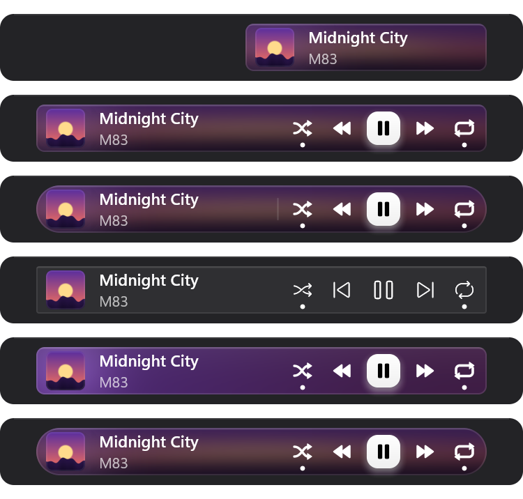
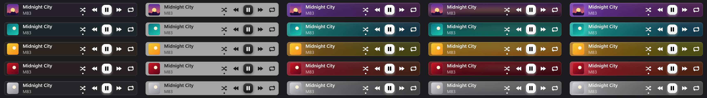
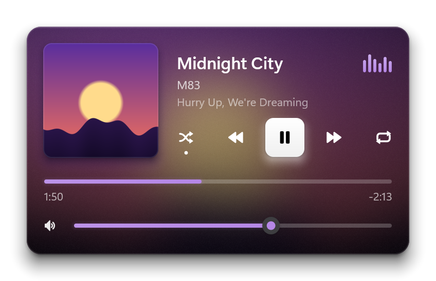
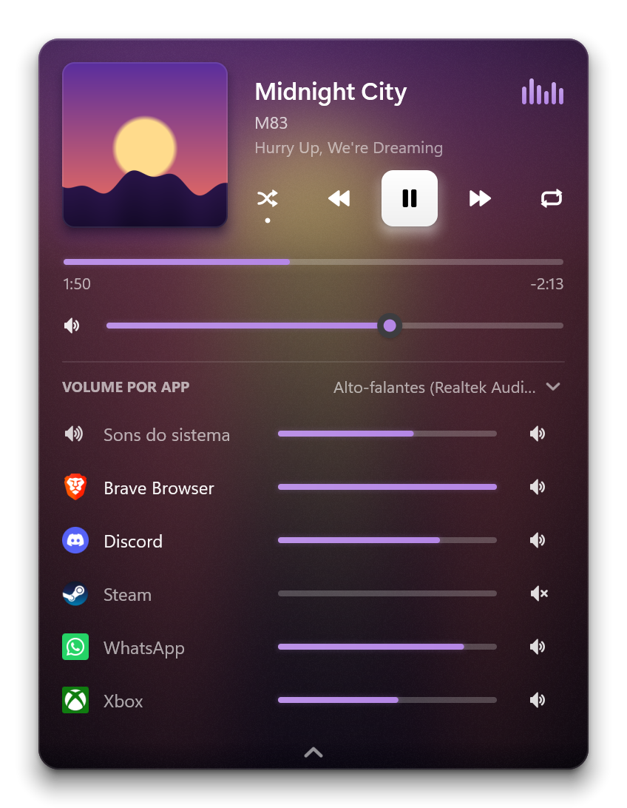
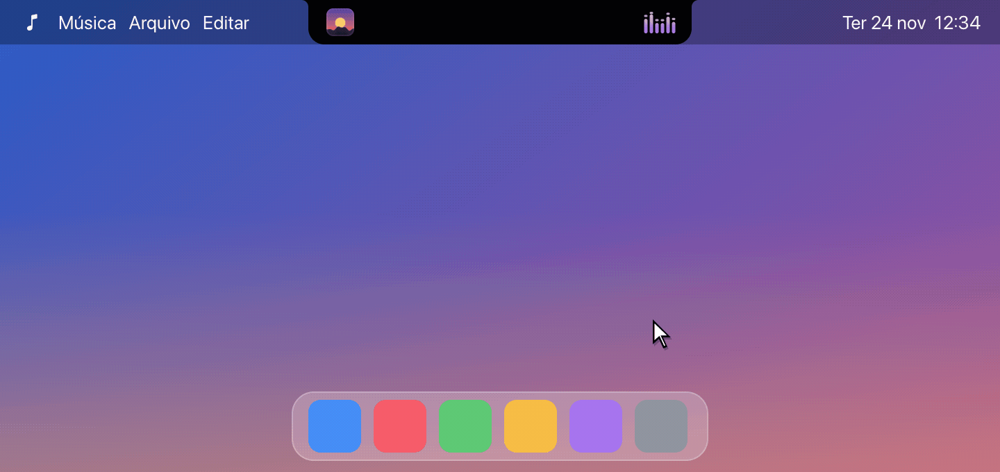
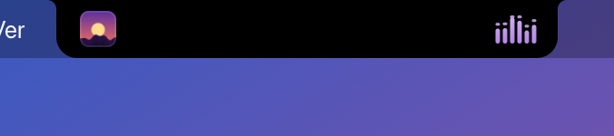
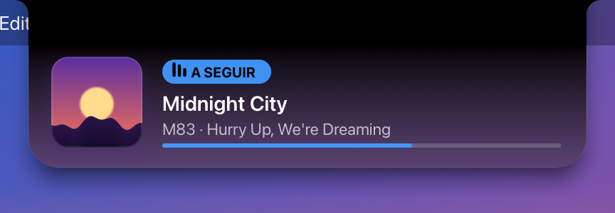

<p align="center">
  
</p>

<h1 align="center">Taskbeat</h1>

<p align="center">
  <b>A música que está tocando, sempre à mão: na barra de tarefas do Windows e no notch do Mac.</b><br>
  Capa, título e controles num widget discreto. Um clique abre o card com tudo.
</p>

<p align="center">
  <a href="https://github.com/Lu1sGabriel/taskbeat/releases/download/v1.3.0/Taskbeat-Setup-1.3.0.exe"><b>⬇ Baixar para Windows 10/11</b></a>
  &nbsp;·&nbsp;
  <a href="https://github.com/Lu1sGabriel/taskbeat/releases/download/v1.3.0/Taskbeat-1.3.0.dmg"><b>⬇ Baixar para macOS 12+</b></a>
  &nbsp;·&nbsp;
  <a href="https://github.com/Lu1sGabriel/taskbeat/releases/tag/v1.3.0">Novidades da 1.3.0</a>
</p>

<p align="center">
  
</p>

## O que é

O Taskbeat mostra a música que está tocando num widget pequeno, colado na barra de
tarefas do Windows (ou no notch do MacBook), com a cor da capa. Um clique abre o
card com capa grande, progresso, volume e todos os controles.

Funciona com qualquer player que apareça nos controles de mídia do sistema:
Spotify, YouTube Music, Apple Music, Deezer, TIDAL, VLC, o navegador… E é leve:
parado, praticamente não gasta CPU.

## Recursos

- **Widget na barra de tarefas** com capa, música e botões, num fundo que pega a
  cor da capa. Dá para arrastar pela barra.
- **Card expandido** com capa grande, progresso, volume, aleatório e repetir (uma
  bolinha mostra quando estão ligados) e mini barras que dançam com o som.
- **Mixer de volume** (Windows): o volume de cada app, como no Mixer do Windows, e
  a troca da saída de áudio (fone, caixa de som…) com um clique.
- **"A seguir"**: um cartão com a próxima música quando o player troca sozinho.
- **Aviso de Caps Lock e Num Lock** bonito, no lugar do nada.
- **YouTube Music no navegador**: aleatório e repetir funcionam, mesmo o
  navegador não contando isso ao Windows.
- **Atalhos** para abrir seus apps de música.
- **Do seu jeito**: cores, formatos, tamanhos e posição, com prévia ao vivo.
- **Em português, inglês, espanhol e alemão.**

## Capturas

### Windows

<p align="center">
  
</p>

O widget em vários jeitos (só a música, com os botões, em pílula, com os ícones de
contorno, com o fundo tomado pela capa) e com as cores de cada capa:

<p align="center">
  
</p>
<p align="center">
  
</p>

O card em três estilos (capa desfocada, cor do álbum e acrílico), o mixer de volume
e o "A seguir":

<p align="center">
  
  
  
</p>
<p align="center">
  
  &nbsp;
  
</p>

### Mac

No Mac, o Taskbeat mora no **notch** do MacBook. Fechado, é uma ilha preta com a
capa de um lado e as barras do outro; com o mouse em cima, ela cresce e vira o
card. Sem notch, fica no meio da barra de menus.

<p align="center">
  
</p>
<p align="center">
  
  
</p>

## Baixar e instalar

### Windows 10 ou 11

1. Baixe o **[Taskbeat-Setup-1.3.0.exe](https://github.com/Lu1sGabriel/taskbeat/releases/download/v1.3.0/Taskbeat-Setup-1.3.0.exe)**.
2. Abra o arquivo. Como o app ainda não tem assinatura digital, o Windows pode
   mostrar **"O Windows protegeu o computador"**: clique em **Mais informações** →
   **Executar assim mesmo**.
3. Clique em **Instalar** (ou **Atualizar**, se já tiver uma versão). Não precisa
   de administrador.

### macOS 12 ou mais novo

1. Baixe o **[Taskbeat-1.3.0.dmg](https://github.com/Lu1sGabriel/taskbeat/releases/download/v1.3.0/Taskbeat-1.3.0.dmg)**,
   abra e arraste o **Taskbeat** para **Aplicativos**.
2. Na primeira vez o macOS bloqueia (o app ainda não é notarizado pela Apple).
   Clique em **Concluído**, abra **Ajustes do Sistema → Privacidade e Segurança**
   e, lá embaixo, clique em **Abrir Mesmo Assim**. Abra o Taskbeat de novo e
   confirme.
3. O macOS pede para gravar o áudio do sistema (para as barras) e, com o Spotify,
   para automatizá-lo (aleatório e repetir). Nada é gravado nem guardado.

Para remover: no Windows, **Configurações → Apps → Taskbeat → Desinstalar**; no
Mac, arraste o app para o Lixo.

## Por que Rust

O Taskbeat fica aberto o dia todo, então precisa ser leve. O Rust ajuda nisso:

- **Sem runtime nem coletor de lixo**: nada rodando por trás, nada de pausas.
- **Rápido como C/C++**: compila para código nativo, e o desenho do app é feito
  por ele mesmo, sem um navegador embutido.
- **Pouca memória e CPU**: parado, gasta praticamente 0% de CPU.
- **Um único arquivo pequeno**: o instalador é o próprio app, com uns 2,5 MB.
- **Seguro com a memória**: o compilador impede classes inteiras de bugs (acesso
  a memória já liberada, corridas entre threads), o que importa num app que nunca
  fecha.

## Por trás dos panos

Sem entrar em detalhes, o Taskbeat conversa direto com o sistema:

- **Windows**: a música e os controles vêm dos **controles de mídia do sistema**
  (SMTC), os mesmos do painel de volume do Windows. As barras e o mixer usam o
  **WASAPI**, o áudio do Windows. O desenho é feito pelo próprio app (com
  anti-aliasing, desfoque e sombras), o texto com o **DirectWrite**, e tudo
  aparece em **janelas em camadas** transparentes, coladas na barra de tarefas.
- **Mac**: a música vem do **Tocando Agora** (MediaRemote), as barras do
  **Core Audio**, e a ilha e as configurações são janelas do **AppKit**.
- **Só trabalha quando precisa**: não redesenha o que não mudou, segue o ritmo do
  monitor nas animações e só capta o som quando as barras estão à vista.

Medido num Windows com i5-10400F:

| Situação | CPU (de um núcleo) | Memória |
|---|---|---|
| Parado, música pausada | ~0% | ~5 a 20 MB |
| Card aberto | ~0,3% | ~20 MB |
| Card com o mixer aberto | ~0,7% | ~22 MB |

## Próximos passos

- **Linux**: o widget no painel do GNOME e do KDE, com a música pelo MPRIS e o
  som pelo PipeWire.
- **Assinatura de código**: o pedido na SignPath Foundation está em análise; com
  ela, o aviso do Windows na instalação some.
- **Mixer de volume no Mac**, se o macOS deixar controlar o volume por app.
- **Mais players do navegador** com aleatório e repetir (como já funciona com o
  YouTube Music).
- **Letra da música** no card.

## Para desenvolvedores

```powershell
cargo build --release      # Windows: target\release\taskbeat.exe
.\build-installer.ps1      # Windows: dist\Taskbeat-Setup-<versão>.exe
```

```bash
./build-macos.sh           # Mac: dist/Taskbeat.app e dist/Taskbeat-<versão>.dmg
```

## Licença

O Taskbeat é distribuído sob a [licença MIT](LICENSE). As bibliotecas de terceiros
(todas com licenças permissivas) estão listadas, com seus avisos de copyright, em
[THIRD-PARTY-NOTICES.md](THIRD-PARTY-NOTICES.md). As fontes Segoe e os SF Symbols
são do próprio Windows e do próprio macOS e não são distribuídos com o app.

## Créditos

Desenvolvido por Luis Goés com o auxílio do [Claude Code](https://claude.com/claude-code),
a ferramenta de programação com IA da Anthropic.
