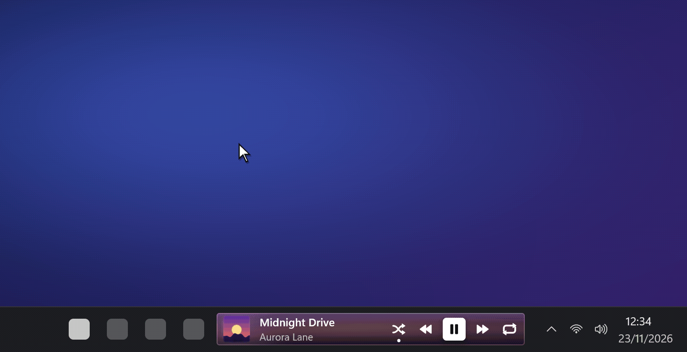
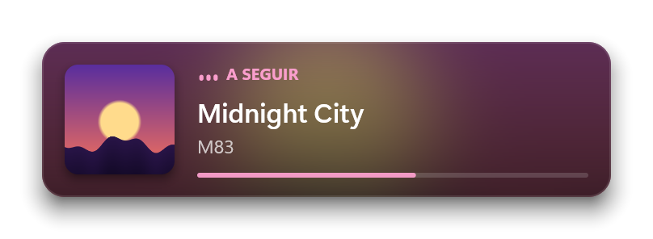
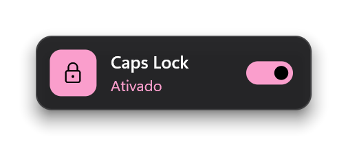
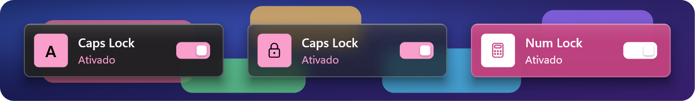

# Taskbeat

Widget de música para a barra de tarefas do Windows 10/11, feito em Rust, no estilo
Fluent do Windows 11 (referências: FluentFlyout, Fluent 2 e cards de "now playing" do Dribbble).


> Projeto desenvolvido com o auxílio do [Claude Code](https://claude.com/claude-code).

**[⬇ Baixar o Taskbeat 1.1.0 (Windows 10/11)](https://github.com/Lu1sGabriel/taskbeat/releases/download/v1.1.0/Taskbeat-Setup-1.1.0.exe)** · [notas da versão](https://github.com/Lu1sGabriel/taskbeat/releases/tag/v1.1.0) · [todas as versões](https://github.com/Lu1sGabriel/taskbeat/releases)

<p align="center">
  
</p>

## Capturas de tela

<p align="center">
  
</p>

**Widget da barra**: tudo dentro do mesmo fundo — capa, música, indicador e, se quiser, os
botões (aleatório, anterior, play, próximo, repetir), em formato arredondado, pílula ou reto:

<p align="center">
  
</p>

**Card expandido** em três estilos: capa desfocada, cor do álbum e acrílico (desfoca o que está atrás).

<p align="center">
  
  
  
</p>

**"A seguir"** (quando o player troca de música sozinho) e **aviso de Caps Lock**:

<p align="center">
  
  
</p>

Aviso de teclas com fundo **sólido**, **acrílico** ou na **cor de destaque**, e ícone de letra, cadeado ou teclado:

<p align="center">
  
</p>

**Configurações** com prévia ao vivo e **instalador**:

<p align="center">
  
  
</p>

## O que faz

- **Na barra de tarefas** (compacto): capa + título/artista, indicador animado
  "tocando agora" e letreiro para títulos longos, tudo dentro de um único fundo.
  Fica sempre na barra (com "Nada tocando" quando não há música; dá para desligar).
  Os botões de mídia entram no mesmo fundo (⏮ ▶ ⏭, mais aleatório e repetir
  opcionais), com separador, play preenchido ou só ícone e formato do fundo
  (arredondado, pílula, reto); dá para deixá-los só no card. Dá para escolher a
  segunda linha (artista, artista · álbum, álbum ou tempo), o tamanho da capa e
  do texto, a cor do fundo (neutra, da capa ou de destaque), a opacidade e o
  contorno. Ao trocar de música, o título novo desliza e a capa nova aparece
  suavemente (opcional).
- **Card expandido** (clique na música): capa grande, aleatório / anterior / play /
  próximo / repetir, barra de progresso arrastável e volume. O app de origem
  (Spotify, Brave…) fica escondido por padrão; com a opção "Mostrar app de
  origem", aparece como selo (ícone + nome) no card e no "A seguir", e como um
  selo recortado no canto da capa na barra.
  Fundo **capa desfocada**, **cor do álbum** ou **acrílico** (vidro fosco que
  desfoca o que está atrás); layout horizontal ou vertical; tema; cor de destaque
  (capa ou Windows); cantos; formato do play. Mostra também o álbum, quando o
  player informa. Aleatório e repetir aparecem sempre (apagados nos players que
  não deixam mudar pelo Windows, como os navegadores; clicar explica o porquê)
  ou só quando o player permite.
- **"A seguir"**: cartão animado com a próxima música (capa, título, artista e
  álbum), só quando o player troca de faixa sozinho (trocas manuais não mostram),
  inclusive quando você pula para o fim da música. Com o card aberto, aparece
  empilhado acima dele. Espera um instante pela capa nova antes de aparecer.
- **Caps Lock / Num Lock**: aviso animado opcional ao ligar/desligar, com posição
  (centro da tela, topo ou acima do player, mais ajuste fino horizontal/vertical),
  fundo sólido, acrílico ou na cor de destaque (com opacidade e intensidade do
  desfoque), ícone (letra, cadeado ou teclado), animação (deslizar, zoom ou
  esmaecer), cantos, tamanho, tema, duração e botão "Mostrar agora". Só essas duas
  teclas são observadas; nada do que você digita é lido.
- **Barras de áudio dinâmicas**: mini visualizador ao lado da música, nas cores
  da capa (dá para desligar; com a música pausada, ficam em repouso).
- **Configurações** (clique no ícone da bandeja): janela Fluent com fundo Mica,
  abre maximizada (redimensionável), pré-visualização ao vivo de cada componente
  sempre à vista (fica fixa no topo enquanto as opções rolam), rolagem suave no
  ritmo do monitor, interruptores e seletores animados, e transição entre
  páginas. Opções que dependem de outra (ex.: aleatório/repetir na barra sem os
  botões da barra) ficam apagadas e desligadas, com uma dica explicando o que
  ligar antes.
- **Menu da bandeja** (botão direito no ícone): no mesmo visual (acrílico,
  cantos arredondados), com a música atual, botões de mídia e interruptores.
  As listas das configurações usam o mesmo menu.

Funciona com qualquer player que publique no painel de mídia do Windows (SMTC):
Spotify, YouTube / YouTube Music no navegador, Apple Music, Deezer, TIDAL, VLC,
Media Player… Aleatório/repetir só aparecem em players que os expõem ao Windows
(ex.: Spotify, Media Player). Navegadores (Brave, Chrome, Edge, Firefox) não expõem
esses comandos, então os botões somem nesse caso.

## Desempenho

Pensado para PCs modestos (medido no build release, i5-10400F):

| Situação | CPU | RAM (working set) |
|---|---|---|
| Música pausada, padrão | ~0,2% de 1 núcleo | ~5 MB após assentar |
| Configurações abertas, paradas | ~0,2–2% de 1 núcleo (conforme a prévia; pausada, ~0,2%) | ~30 MB (volta a ~8 MB ao fechar) |
| Configurações rolando (60 fps) | ~10% de 1 núcleo | — |
| Barras dinâmicas ligadas | ~0,2–0,5% de 1 núcleo | ~12 MB |
| Versão anterior | ~1% de 1 núcleo | ~35 MB |

Como:
- Captura de áudio (WASAPI) **só com o visualizador ligado**.
- Mídia **orientada a eventos** do Windows (troca de sessão/música/play-pause), com checagem de segurança a cada 2 s.
- Threads de segundo plano em **EcoQoS** + prioridade abaixo do normal (Windows 11 usa núcleos/frequências econômicos).
- O widget **não redesenha quando nada muda**; repouso a 4 fps; 30 fps só para o indicador/letreiro; animações no **ritmo do monitor** (vblank, sem engasgos), e só enquanto animam.
- Cópias de dados e consultas só quando algo muda (versão da mídia, tema por mensagem do sistema, volume só com o card aberto).
- Memória de inicialização e da tela de configurações devolvida ao Windows.
- Configurações: a coluna de opções é desenhada uma vez e só copiada ao rolar;
  passar o mouse, clicar ou arrastar redesenha só a linha afetada; a prévia só
  refaz o componente que mexe e só quando o quadro muda; textos das outras
  páginas são preparados aos poucos em segundo plano; nada roda quando nada anima.
- Desenho por software com caminhos rápidos em inteiros (preenchimento, texto e
  composição), em vez de ponto flutuante pixel a pixel.
- Build: `lto = "fat"`, `codegen-units = 1`, `panic = "abort"`, `strip` (Rust Performance Book).

## Como funciona

| Parte | API do Windows | Arquivo |
|---|---|---|
| Áudio de qualquer app | WASAPI *loopback* | `src/audio.rs` |
| Música, capa, controles, linha do tempo, eventos | `GlobalSystemMediaTransportControlsSessionManager` | `src/media.rs` |
| Nome/ícone do app de origem | Pasta Aplicativos do shell (AUMID) → ícone do .exe | `src/appicon.rs` |
| Volume | `IAudioEndpointVolume` | `src/volume.rs` |
| Espectro | Hann + FFT 4096 (`realfft`), bandas log, AGC | `src/dsp.rs` |
| Desenho (widget, card, "A seguir", Caps Lock) | Renderização própria com anti-aliasing (SDF), desfoque, sombras | `src/ui.rs`, `src/render.rs` |
| Janelas sobre a barra | Janelas *layered* com alfa por pixel, topmost; o widget pertence à barra (não some atrás dela quando ela é ativada) | `src/overlay.rs` |
| Fundo acrílico | Captura do que está atrás (antes de a janela aparecer), redução, desfoque, saturação, tinta e granulado | `src/overlay.rs`, `src/render.rs` |
| Texto e ícones | DirectWrite (Direct2D em software, antialias em tons de cinza nas duas direções) → máscaras; fallback GDI | `src/text.rs` |
| Capas reduzidas | Pirâmide de mipmaps (sem serrilhado ao encolher) | `src/render.rs` |
| Posição | `Shell_TrayWnd` + `TrayNotifyWnd`, DPI por monitor, oculta em tela cheia | `src/taskbar.rs` |
| Configurações | Janela desenhada pelo app, Mica (`DWMWA_SYSTEMBACKDROP_TYPE`) | `src/settings.rs` |
| Bandeja | `Shell_NotifyIconW` | `src/tray.rs` |
| Menu (bandeja e listas) | Janela *layered* própria, acrílico, loop modal | `src/menu.rs` |
| Ritmo das animações | Thread que espera o vblank (DXGI `WaitForVBlank`; sem DXGI, `DwmFlush`) | `src/vsync.rs` |
| Ícone e versão do .exe | `app.rc` compilado pelo `rc.exe` do Windows SDK (`build.rs`) | `assets/` |

## Idiomas

Português (Brasil), inglês, espanhol e alemão. Segue o idioma de exibição do
Windows; se não for um desses, usa inglês. Dá para escolher outro em
Configurações > Geral > Idioma. Traduções em `src/i18n.rs` (a chave é o texto
em português; um teste garante que toda tela tem tradução).

## Instalador

```powershell
.\build-installer.ps1
```

Gera `dist\Taskbeat-Setup-<versão>.exe` (um arquivo só, ~2 MB). O próprio
`taskbeat.exe` é o instalador quando tem "setup" no nome (ou com `--install`):

- Janela no visual do app, pasta de instalação escolhível (padrão
  `%LOCALAPPDATA%\Programs\Taskbeat`), iniciar com o Windows, atalho na área de
  trabalho e abrir ao terminar.
- Por usuário, sem administrador. Atalho no Menu Iniciar e registro em
  Configurações > Apps instalados.
- Rodar de novo detecta a versão instalada e compara com a do instalador: mostra
  **Atualização disponível (v1.0.1 → v1.1.0)** e atualiza no mesmo lugar, sem
  desinstalar, mantendo configurações, atalhos e inicialização (fecha o app antes e
  abre de novo no fim). Com a mesma versão oferece **Reinstalar**; com uma mais nova
  instalada avisa antes de voltar a versão.
- Desinstalar: pelo "Apps instalados" (`Taskbeat.exe --uninstall`), com opção de
  apagar também as configurações.

O executável não é assinado digitalmente: na primeira vez, o SmartScreen mostra
"O Windows protegeu o computador" → **Mais informações** → **Executar assim mesmo**.

## Rodar

```powershell
cargo run --release
```

Configurações em `%APPDATA%\Taskbeat\config.toml` (preferências da versão
anterior, em `%APPDATA%\TaskbarVisualizer`, são lidas automaticamente).

Para testar sem esperar: `$env:TV_DEMO_FLYOUT=1` (card), `$env:TV_DEMO_POPUP=1`
("A seguir") ou `$env:TV_DEMO_CAPS=1` (Caps Lock) antes de iniciar.

Regenerar o ícone: `python assets/make_icon.py`.

Regenerar as capturas do card, "A seguir" e Caps Lock (desenhadas pelo próprio
código, com a música de exemplo):

```powershell
$env:TASKBEAT_LANG="pt"; cargo test --release shots -- --ignored
```

E o GIF animado (`docs/screenshots/demo.gif`, com codificador GIF próprio):

```powershell
$env:TASKBEAT_LANG="pt"; cargo test --release demo_gif -- --ignored
```

`$env:TV_DEMO_MEDIA=1` faz as prévias da tela de configurações usarem a música de exemplo.

Diagnóstico (ex.: o "A seguir" não apareceu): `$env:TASKBEAT_LOG="$env:TEMP\taskbeat.log"`
antes de abrir o app grava cada leitura do player e cada troca de faixa
(automática ou manual) nesse arquivo, também no build release.

## Limitações

- Só a barra do monitor principal.
- A tela de configurações ainda não tem navegação por teclado.

## Licença

O Taskbeat é distribuído sob a [licença MIT](LICENSE): pode usar, copiar, modificar
e distribuir, mantendo o aviso de copyright.

As bibliotecas de terceiros usadas (todas com licenças permissivas: MIT, Apache-2.0 e
Unicode-3.0) estão listadas, com seus avisos de copyright, em
[THIRD-PARTY-NOTICES.md](THIRD-PARTY-NOTICES.md). Para atualizar a lista:
`python tools/third_party_notices.py`.

As fontes Segoe UI Variable e Segoe Fluent Icons são do próprio Windows e não são
distribuídas com o app.

## Créditos

Desenvolvido por Luis Goés com o auxílio do [Claude Code](https://claude.com/claude-code),
a ferramenta de programação com IA da Anthropic.
