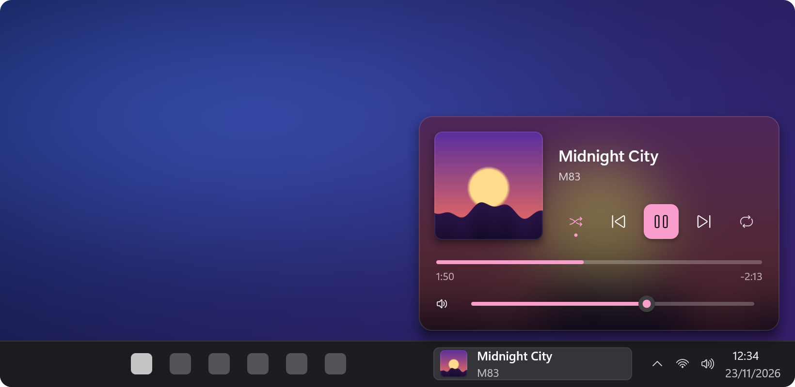
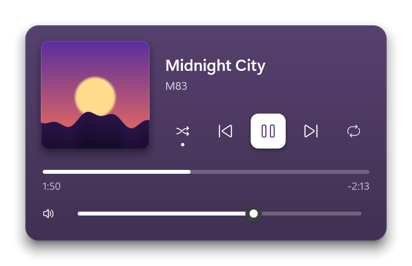
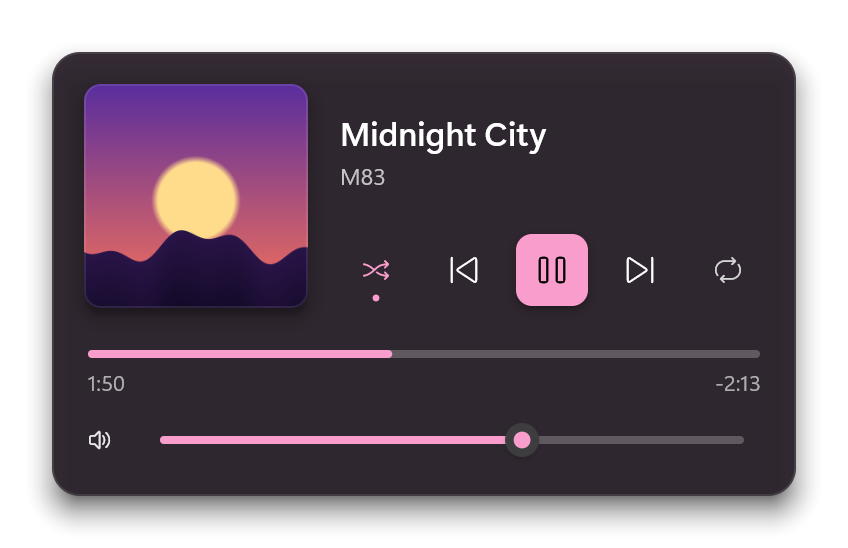
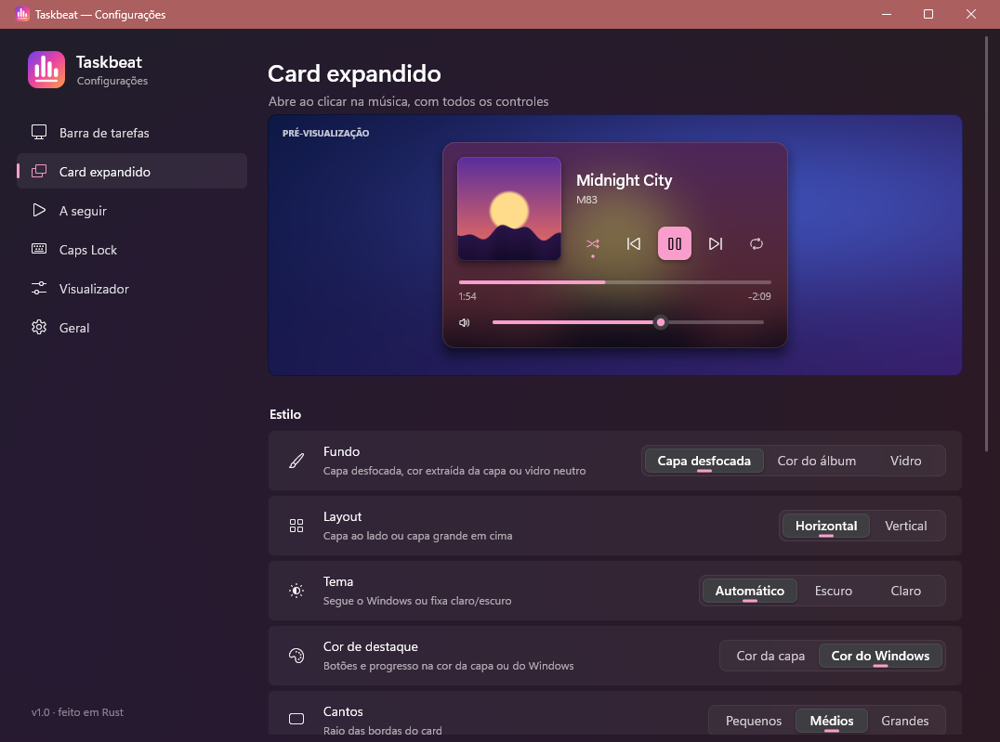
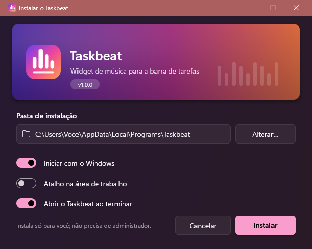

# Taskbeat

Widget de música para a barra de tarefas do Windows 10/11, feito em Rust, no estilo
Fluent do Windows 11 (referências: FluentFlyout, Fluent 2 e cards de "now playing" do Dribbble).


> Projeto desenvolvido com o auxílio do [Claude Code](https://claude.com/claude-code).

**[⬇ Baixar o instalador (Windows 10/11)](https://github.com/Lu1sGabriel/taskbeat/releases/latest)**

<p align="center">
  
</p>

## Capturas de tela

**Card expandido** em três estilos: capa desfocada, cor do álbum e vidro.

<p align="center">
  
  
  
</p>

**"A seguir"** (quando o player troca de música sozinho) e **aviso de Caps Lock**:

<p align="center">
  
  
</p>

**Configurações** com prévia ao vivo e **instalador**:

<p align="center">
  
  
</p>

## O que faz

- **Na barra de tarefas** (compacto): capa + título/artista, indicador animado
  "tocando agora" e letreiro para títulos longos. Os botões ⏮ ▶ ⏭ ficam no card
  por padrão (opcionalmente também na barra).
- **Card expandido** (clique na música): capa grande, aleatório / anterior / play /
  próximo / repetir, barra de progresso arrastável e volume. O app de origem
  (Spotify, Brave…) fica escondido por padrão (opção "Mostrar app de origem").
  Fundo **capa desfocada**, **cor do álbum** ou **vidro**; layout horizontal ou
  vertical; tema; cor de destaque (capa ou Windows); cantos; formato do play.
- **"A seguir"**: cartão animado com a próxima música, só quando o player troca de
  faixa sozinho (trocas manuais não mostram).
- **Caps Lock / Num Lock**: aviso animado opcional ao ligar/desligar, com posição
  (centro da tela, topo ou acima do player, mais ajuste fino horizontal/vertical),
  cantos, tamanho, tema, duração e botão "Mostrar agora". Só essas duas teclas são
  observadas; nada do que você digita é lido.
- **Barras de áudio dinâmicas** (desligadas por padrão): mini visualizador.
- **Configurações** (clique no ícone da bandeja): janela Fluent com fundo Mica,
  redimensionável/maximizável, pré-visualização ao vivo de cada componente,
  controles segmentados e rolagem suave a 60 fps.

Funciona com qualquer player que publique no painel de mídia do Windows (SMTC):
Spotify, YouTube / YouTube Music no navegador, Apple Music, Deezer, TIDAL, VLC,
Media Player… Aleatório/repetir só aparecem em players que os expõem ao Windows
(ex.: Spotify, Media Player). Navegadores (Brave, Chrome, Edge, Firefox) não expõem
esses comandos, então os botões somem nesse caso.

## Desempenho

Pensado para PCs modestos (medido no build release, i5-10400F):

| Situação | CPU | RAM (working set) |
|---|---|---|
| Música pausada, padrão | ~0,1% de 1 núcleo | ~11 MB (≈3 MB após assentar) |
| Configurações abertas, paradas | ~0,5% de 1 núcleo | ~50 MB (volta a ~2 MB ao fechar) |
| Configurações rolando | ~4% de 1 núcleo | — |
| Barras dinâmicas ligadas | ~0,2–0,5% de 1 núcleo | ~12 MB |
| Versão anterior | ~1% de 1 núcleo | ~35 MB |

Como:
- Captura de áudio (WASAPI) **só com o visualizador ligado**.
- Mídia **orientada a eventos** do Windows (troca de sessão/música/play-pause), com checagem de segurança a cada 2 s.
- Threads de segundo plano em **EcoQoS** + prioridade abaixo do normal (Windows 11 usa núcleos/frequências econômicos).
- O widget **não redesenha quando nada muda**; repouso a 4 fps; 30 fps só para o indicador/letreiro; 60 fps apenas durante interação/animação.
- Cópias de dados e consultas só quando algo muda (versão da mídia, tema por mensagem do sistema, volume só com o card aberto).
- Memória de inicialização e da tela de configurações devolvida ao Windows.
- Configurações: a coluna de opções é desenhada uma vez e só copiada ao rolar;
  a prévia animada redesenha apenas a própria área; timer parado quando nada anima.
- Build: `lto = "fat"`, `codegen-units = 1`, `panic = "abort"`, `strip` (Rust Performance Book).

## Como funciona

| Parte | API do Windows | Arquivo |
|---|---|---|
| Áudio de qualquer app | WASAPI *loopback* | `src/audio.rs` |
| Música, capa, controles, linha do tempo, eventos | `GlobalSystemMediaTransportControlsSessionManager` | `src/media.rs` |
| Nome/ícone do app de origem | Pasta Aplicativos do shell (AUMID) → ícone do .exe | `src/appicon.rs` |
| Volume | `IAudioEndpointVolume` | `src/volume.rs` |
| Espectro | Hann + FFT 4096 (`realfft`), bandas log, AGC | `src/dsp.rs` |
| Desenho (widget, card, "A seguir", Caps Lock) | Renderização própria com anti-aliasing (SDF), desfoque, sombras | `src/ui.rs`, `src/render.rs` |
| Janelas sobre a barra | Janelas *layered* com alfa por pixel, topmost | `src/overlay.rs` |
| Texto e ícones | DirectWrite (Direct2D em software, antialias em tons de cinza nas duas direções) → máscaras; fallback GDI | `src/text.rs` |
| Capas reduzidas | Pirâmide de mipmaps (sem serrilhado ao encolher) | `src/render.rs` |
| Posição | `Shell_TrayWnd` + `TrayNotifyWnd`, DPI por monitor, oculta em tela cheia | `src/taskbar.rs` |
| Configurações | Janela desenhada pelo app, Mica (`DWMWA_SYSTEMBACKDROP_TYPE`) | `src/settings.rs` |
| Bandeja | `Shell_NotifyIconW` | `src/tray.rs` |
| Ícone e versão do .exe | `app.rc` compilado pelo `rc.exe` do Windows SDK (`build.rs`) | `assets/` |

## Idiomas

Português (Brasil), inglês, espanhol e alemão. Segue o idioma de exibição do
Windows; se não for um desses, usa inglês. Dá para escolher outro em
Configurações > Geral > Idioma. Traduções em `src/i18n.rs` (a chave é o texto
em português; um teste garante que toda tela tem tradução).

## Instalador

```powershell
.\build-installer.ps1
```

Gera `dist\Taskbeat-Setup-<versão>.exe` (um arquivo só, ~2 MB). O próprio
`taskbeat.exe` é o instalador quando tem "setup" no nome (ou com `--install`):

- Janela no visual do app, pasta de instalação escolhível (padrão
  `%LOCALAPPDATA%\Programs\Taskbeat`), iniciar com o Windows, atalho na área de
  trabalho e abrir ao terminar.
- Por usuário, sem administrador. Atalho no Menu Iniciar e registro em
  Configurações > Apps instalados.
- Rodar de novo atualiza por cima (fecha o app aberto antes).
- Desinstalar: pelo "Apps instalados" (`Taskbeat.exe --uninstall`), com opção de
  apagar também as configurações.

O executável não é assinado digitalmente: na primeira vez, o SmartScreen mostra
"O Windows protegeu o computador" → **Mais informações** → **Executar assim mesmo**.

## Rodar

```powershell
cargo run --release
```

Configurações em `%APPDATA%\Taskbeat\config.toml` (preferências da versão
anterior, em `%APPDATA%\TaskbarVisualizer`, são lidas automaticamente).

Para testar sem esperar: `$env:TV_DEMO_FLYOUT=1` (card), `$env:TV_DEMO_POPUP=1`
("A seguir") ou `$env:TV_DEMO_CAPS=1` (Caps Lock) antes de iniciar.

Regenerar o ícone: `python assets/make_icon.py`.

Regenerar as capturas do card, "A seguir" e Caps Lock (desenhadas pelo próprio
código, com a música de exemplo):

```powershell
$env:TASKBEAT_LANG="pt"; cargo test --release shots -- --ignored
```

`$env:TV_DEMO_MEDIA=1` faz as prévias da tela de configurações usarem a música de exemplo.

## Limitações

- Só a barra do monitor principal.
- A tela de configurações ainda não tem navegação por teclado.

## Créditos

Desenvolvido por Luis Goés com o auxílio do [Claude Code](https://claude.com/claude-code),
a ferramenta de programação com IA da Anthropic.
